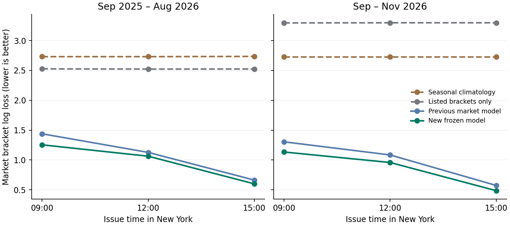

# LGA 当日最高温能预测到哪个挂牌区间？

纽约当地 09:00、12:00、15:00 分别预测当天 Polymarket 已挂牌的各个温度区间。每天用真实结算的唯一赢家计算分数。课程五档仍有助于衡量大范围气温变化，真实合约则检验模型能否区分相邻几度。

## 历史结果

旧模型是项目上一轮按真实合约选出的冠军。09:00 用 15 叶梯度提升回归修正天气预报，12:00 和 15:00 用岭回归修正，再把校准误差分布加总到挂牌区间。新旧模型的最终拟合都截至 2025-08-31。

| 区间 | 发报 | 共同日期 | 旧 → 新命中率 | 旧 → 新 log loss | 新减旧（95% 周区间） | 旧 → 新 Brier |
|---|---|---|---|---|---|---|
| 主回放 | 09:00 | 348 | 42.5% → 48.0% | 1.439 → 1.254 | -0.185 [-0.280, -0.085] | 0.685 → 0.624 |
| 主回放 | 12:00 | 348 | 50.6% → 58.9% | 1.128 → 1.064 | -0.064 [-0.174, +0.041] | 0.593 → 0.556 |
| 主回放 | 15:00 | 346 | 70.5% → 72.0% | 0.664 → 0.601 | -0.063 [-0.138, +0.015] | 0.392 → 0.342 |
| 秋季回放 | 09:00 | 67 | 50.7% → 55.2% | 1.305 → 1.134 | -0.171 [-0.230, -0.110] | 0.657 → 0.594 |
| 秋季回放 | 12:00 | 67 | 55.2% → 56.7% | 1.085 → 0.958 | -0.126 [-0.223, -0.016] | 0.584 → 0.544 |
| 秋季回放 | 15:00 | 67 | 77.6% → 80.6% | 0.574 → 0.487 | -0.087 [-0.180, +0.022] | 0.319 → 0.288 |

按预先冻结的配置，三个时点在两段回放中的平均命中率、log loss 和 Brier 都优于既有冠军。上午的配对损失区间在两段回放中都低于零。中午在秋季回放中达到这一条件。下午的两段区间都跨零，需更多独立日期来判断损失优势能否复现。

主回放为 2025-09-01 至 2026-08-31，秋季为 2026-09-01 至 2026-11-06。两段分开配对。log loss 衡量模型给实际赢家的概率，数值越小越好。给错区间过高置信度会被重罚。Brier 同时衡量全部区间的概率偏差。周区间来自 5,000 次配对七日分块重采样，差值区间跨零表示改善方向尚不确定。这些日期在此前的项目研究中已经使用过。

## 检验季节是否已经足以猜对

| 发报 | 季节猜课程五档：命中率 | 季节猜实际档：命中率 / 损失 | 仅知挂牌：命中率 / 损失 | HRRR 基准：命中率 / 损失 | 新模型：命中率 / 损失 |
|---|---|---|---|---|---|
| 09:00 | 54.9% | 7.8% / 2.731 | 19.0% / 2.527 | 39.4% / 1.527 | 48.0% / 1.254 |
| 12:00 | 54.9% | 7.8% / 2.731 | 19.0% / 2.523 | 38.2% / 1.416 | 58.9% / 1.064 |
| 15:00 | 54.9% | 7.5% / 2.735 | 19.1% / 2.524 | 63.3% / 0.900 | 72.0% / 0.601 |

季节基准只用训练期历史温度，按日历日的周期距离加权，再将整度概率加到当天挂牌区间。挂牌基准只学习过去已结算赢家在挂牌列表中的相对位置。HRRR 基准使用已有数值预报、观测下界及历史残差校正。三者都在新模型的相同市场日期评分。

| 季节分组 | 冬季 | 春季 | 夏季 | 秋季 |
|---|---|---|---|---|
| 09:00 | 51.8% / 1.110（85 天） | 50.6% / 1.335（85 天） | 38.5% / 1.361（91 天） | 53.2% / 1.174（154 天） |
| 12:00 | 54.1% / 0.926（85 天） | 51.8% / 1.230（85 天） | 64.8% / 1.089（91 天） | 61.0% / 0.988（154 天） |
| 15:00 | 82.1% / 0.427（84 天） | 65.5% / 0.549（84 天） | 63.7% / 0.860（91 天） | 78.6% / 0.522（154 天） |

上表合并两段回放，按当地气象季节分组。各季样本量和挂牌难度不同。以下例子取主回放中冬季和夏季各自第一个有 09:00 合约的日期。

- 2025-12-01 共 7 档，两端为 36°F or below 和 47°F or higher。前三档为 **41-42°F** 48.8%、**43-44°F** 41.8%、**45-46°F** 8.6%。最终结算 **43-44°F**，模型给它 41.8%。

- 2026-06-01 共 11 档，两端为 67°F or below 和 86°F or higher。前三档为 **70-71°F** 48.1%、**72-73°F** 27.2%、**68-69°F** 15.6%。最终结算 **68-69°F**，模型给它 15.6%。

## 为什么选这些模型，参数怎样决定

项目存档中的实际合约始于 2025-01-22。将 2025 年 1–2 月、3–4 月设为两个前向初选折，比较 5 种固定模型 × 3 套输入，再锁定每个时点的一套方案。随后在 5–6 月、7–8 月两个前向折，只对入选模型搜索参数。每折仅用更早的天气标签拟合，仅按折内已结算的真实合约评价，每折平均损失等权。模型初选差距不超过 0.001 时优先选择来源更少、结构更简单的方案。

候选包括共享阈值逻辑回归、对相邻温度阈值施加单调约束的 XGBoost、学习预报误差均值和不确定性的 CatBoost、分别学习继续升温概率与正升温幅度的两阶段模型，以及阈值回归和两阶段模型的等权组合。每种都比较四机场、四机场＋HRRR、四机场＋HRRR＋NBM 三套输入。

| 发报 | 选中模型 / 数据 | 初选损失 | 次优固定方案（损失） | 最终参数 | 调参折默认 → 最优损失 |
|---|---|---|---|---|---|
| 09:00 | 阈值逻辑回归＋两阶段升温（各 50%） / NBM | 1.1538 | 共享阈值逻辑回归 / NBM（1.1620） | C=4.071，深度 6，学习率 0.0907，333 棵树，L2=1.399 | 1.2751 → 1.2501 |
| 12:00 | 单调 XGBoost / NBM | 0.9791 | 阈值逻辑回归＋两阶段升温（各 50%） / NBM（1.0257） | 深度 6，学习率 0.01731，426 棵树，L2=3.593 | 1.1328 → 1.0900 |
| 15:00 | 单调 XGBoost / NBM | 0.5490 | CatBoost 温度分布回归 / NBM（0.5539） | 深度 6，学习率 0.01501，939 棵树，L2=4.995 | 0.5997 → 0.5791 |

上午的组合同时估计最高温超过指定阈值的概率，以及从目前高点继续升温的幅度。两种预测等权平均后赢得初选，领先单独阈值回归的幅度很小。中午的单调树在固定参数下对次优方案的领先更明显。下午单调树与温度分布回归的初选成绩接近，按事先确定的损失规则选中了前者。

共享阈值回归把不同分界线上的样本合在一起，C 越小，系数收缩越强。两阶段模型先用逻辑回归估计还会继续升温的概率，再由 CatBoost 拟合正升温量对数的条件分布。组合中两个逻辑组件共用 C，两个成员各占 50%。单调 XGBoost 利用温度相对阈值的距离，同时学习风、云和预报误差的非线性关系。树深控制交互复杂度，学习率控制每轮更新幅度，树数控制总迭代，L2 抑制叶子过拟合。

单调约束保证在其余天气输入相同时，跨过更高温度门槛的概率只能下降或持平。CatBoost 的分布回归同时输出位置和尺度参数，允许同样的预期升温量具有不同的不确定性。[XGBoost 单调约束文档](https://xgboost.readthedocs.io/en/stable/tutorials/monotonic.html) · [CatBoost 回归目标文档](https://catboost.ai/docs/en/concepts/loss-functions-regression)

树模型的每个入选方案保留初选参数，再以种子 4260 抽取 64 组。深度 2–6、学习率 0.015–0.12、迭代数 150–1,000、L2 1–30。涉及逻辑回归时 C 为 0.01–100。深度和树数按整数抽样，连续参数按对数尺度抽样。调参联合改变多个参数，因此只能把收益归给整组参数。初选及调参逐折结果、拟合日期、覆盖和运行秒数保存在各时点的 CSV 中。

## 改进来自数据、结构，还是调参

| 回放 | 发报 | 阈值回归加 NBM：全日期 | 加 NBM：相同训练与评估日期 | 相同输入改模型结构 | 同结构调参 |
|---|---|---|---|---|---|
| 主回放 | 09:00 | -0.177 | -0.179 | +0.007 | +0.017 |
| 主回放 | 12:00 | -0.089 | -0.089 | -0.030 | +0.025 |
| 主回放 | 15:00 | -0.049 | -0.049 | -0.007 | -0.007 |
| 秋季回放 | 09:00 | -0.104 | -0.110 | -0.005 | -0.005 |
| 秋季回放 | 12:00 | -0.075 | -0.081 | -0.047 | +0.019 |
| 秋季回放 | 15:00 | -0.039 | -0.041 | +0.015 | +0.028 |

最一致的收益来自第二套气象预报。固定阈值回归并匹配训练和评估日期后，主回放中三个时点加入 NBM 的损失差值区间都低于零。深搜改善了三个时点的调参折评分，但主回放中上午和中午使用调后参数的损失更高。下午的微弱调参收益也没有在秋季重现。报告保留预先冻结的配置，以免看过回放后再挑参数。

每格为后一种方法减前一种方法的 log loss，负数表示改善。NBM 消融固定阈值回归。结构消融固定入选输入与默认参数。调参消融固定结构与输入。三项对照各自回答不同问题。完整样本量和配对区间见 [paired.csv](paired.csv)。

| 发报 | 课程五档旧 → 新命中率 | 课程五档旧 → 新损失 | 距课程边界 ≤2°F 损失 | 课程五档 Macro F1 | 市场损失：延迟 0 / 15 / 30 分钟 |
|---|---|---|---|---|---|
| 09:00 | 90.6% → 89.8% | 0.251 → 0.212 | 0.564（82 天） | 0.896 | 1.254 / 1.261 / 1.259 |
| 12:00 | 92.2% → 93.6% | 0.202 → 0.160 | 0.473（82 天） | 0.936 | 1.064 / 1.114 / 1.118 |
| 15:00 | 96.1% → 98.3% | 0.087 → 0.060 | 0.217（82 天） | 0.985 | 0.601 / 0.917 / 0.915 |

下午的主要难点是后续升温。两段回放合计，15:00 的已观测整度下界达到最终温度代理时，命中率为 91.6%（239 天）。当最高温此后继续上升时降至 48.3%（174 天）。观测延迟试验也显示下午的概率对最新读数尤其敏感。该分组用事后温度解释误差，预测时并不知道最高温是否已经出现。

课程五档另以相同选中结构重训，目标为保留小时观测的当日最高温。课程档位的硬下界仅由已结束小时确定。市场评分则根据当日合约的测温规则选择整数温度训练目标，区间端点按最近整数华氏度处理，并在挂牌区间间均分 0.1% 的概率，以容纳温度代理与结算来源的差别。挂牌数及定义随日期变化，市场主指标为对真实赢家的 log loss、Brier 和命中率。

## 数据覆盖与复现

NOAA NBM 档案 2021-01-01 至 2026-11-21。三个发报时点可用数依次为 2120/2151, 2128/2151, 2123/2151。在截止前已发布且能覆盖当地当日最后一个整点的 KLGA 小时预报中，提取剩余最高温、峰值时距、峰值温度标准差和平均云量，并计算 NBM 与 HRRR 的分歧。站点卡包含不同 NBM 版本。富数据缺失时按 NBM、HRRR、仅机场顺序回退。较低层使用固定阈值逻辑回归。主评估限于四机场数据齐全的研究时间范围，复用既有模型的相同市场日期。

历史站点报告时间代理实际接收时间。15/30 分钟敏感性试验将站点输入延后，延迟情况下 routine METAR 下界用早一个已结束小时的 LCD 常规报告重建。历史市场档案给出挂牌、关盘和最终规则，缺少逐时改版记录。Weather Underground 等结算来源的逐度天气标签是代理，真实挂牌评分始终以最终结算为准。这个实验评估天气区间概率。

训练使用 numpy 2.2.6, pandas 2.3.3, scikit-learn 1.7.2, xgboost 3.1.1, catboost 1.2.10, scipy 1.18.1。 [命令与数据源说明](../../bracket_study/README.zh-CN.md) · [逐日合约概率](bracket_probabilities.csv.gz) · [分季节、结算规则和升温状态](subgroups.csv) · [输入哈希](inputs.json)
