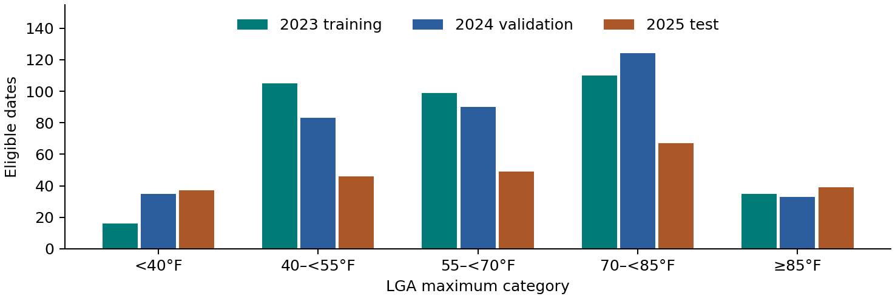
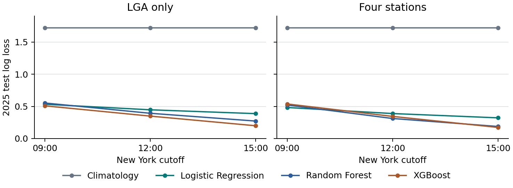

# Probabilistic Weather Forecasting Using Supervised Machine Learning

## CS4260 Progress 1 Report

Mohan Zhang, Mingyeung Wu, Maxwell Liss

## Same Day Prediction Task

We revised the proposal from forecasting tomorrow’s high to estimating today’s final maximum at LaGuardia Airport (LGA). At 09:00, 12:00, and 15:00 New York time, the model returns five probabilities that sum to 1. The categories are below 40°F, 40°F to below 55°F, 55°F to below 70°F, 70°F to below 85°F, and 85°F or higher.

On the 238 eligible 2025 test dates, the validation-selected 15:00 XGBoost recorded 0.173 log loss and 94.1% accuracy. The climatology baseline recorded 1.717 log loss and 28.2% accuracy.

## Data and Eligible Dates

We downloaded 12 NOAA Global Hourly CSVs from the public S3 archive. They cover LGA (72503014732), JFK (74486094789), EWR (72502014734), and TEB (72502594741) for UTC source years 2023 through 2025. The raw manifest records each source URL, byte count, and SHA-256 hash.

LGA defines the target for every model. An eligible New York calendar day has at least 20 valid hourly temperatures and at least one in each six-hour period starting at 00:00, 06:00, 12:00, and 18:00. The target is the largest retained temperature on that day.

| Local year | Split | First and last eligible dates | Eligible | Excluded |
| --- | --- | --- | --- | --- |
| 2023 | Training | 2023-01-01 to 2023-12-31 | 365 | 0 |
| 2024 | Validation | 2024-01-01 to 2024-12-31 | 365 | 1 |
| 2025 | Test | 2025-01-01 to 2025-08-26 | 238 | 127 |

*Excluded dates are measured against the full local calendar year and include dates outside the archive coverage.*

## Features and Chronological Split

Each station contributes its latest temperature, humidity, and wind from an observation at most one hour old, its maximum since midnight, a roughly three-hour temperature change, and its previous calendar day’s observed maximum. The model also uses month. The older reading for the temperature change comes from the hour ending three hours before cutoff.

Each cutoff uses a localized wall-clock time, including on daylight saving dates. We trim readings to the cutoff before keeping the last one per UTC hour. Previous-day maxima use the prior local date and can use partial coverage when present. Missing inputs remain missing until model preprocessing. The 2023 training set alone fits imputers, scaling, and models. We use 2024 to select models and reserve 2025 for testing.

## Observation Cleaning and Category Counts

We kept FM-15 and FM-16 reports. In TMP and DEW, the first field gives tenths of a degree Celsius and the second gives quality. In WND, fields four and five give tenths of a meter per second and quality. We accepted quality codes 0, 1, 4, and 5 and treated sentinel ±9999 and invalid values as missing. Temperature is converted to Fahrenheit and relative humidity is derived from temperature and dew point, clipped to 0–100%.

We parsed observation times as UTC, removed duplicate timestamps, and retained the last report per UTC hour for the exported hourly tables. The original timestamps are preserved and displayed in New York time. Source years in the table follow the UTC file names.

| Station | Source year | Routine reports | Hourly rows | Temp missing | RH missing | Wind missing |
| --- | --- | --- | --- | --- | --- | --- |
| LGA | 2023 | 10393 | 8746 | 3 | 4 | 2 |
| LGA | 2024 | 10255 | 8767 | 2 | 4 | 3 |
| LGA | 2025 | 6715 | 5711 | 2 | 3 | 2 |
| JFK | 2023 | 10190 | 8749 | 2 | 3 | 4 |
| JFK | 2024 | 9907 | 8752 | 4 | 4 | 3 |
| JFK | 2025 | 6623 | 5708 | 5 | 6 | 0 |
| EWR | 2023 | 10107 | 8753 | 4 | 5 | 1 |
| EWR | 2024 | 9940 | 8767 | 5 | 8 | 7 |
| EWR | 2025 | 6456 | 5669 | 28 | 28 | 0 |
| TEB | 2023 | 10476 | 8760 | 40 | 41 | 18 |
| TEB | 2024 | 10400 | 8757 | 21 | 21 | 43 |
| TEB | 2025 | 6618 | 5707 | 8 | 8 | 22 |

*Figure 1. Eligible LGA dates by maximum temperature category and year.*

## Preliminary Model Results

We compared a training class-prior baseline with Logistic Regression, Random Forest, and XGBoost at each cutoff using LGA alone and all four stations. Hyperparameters were fixed. For each cutoff, we selected the non-baseline model and station set with the lowest 2024 validation log loss and kept its 2023-trained model for the demo.

| Cutoff | Selected model | Stations | Validation loss | Test loss | Test accuracy |
| --- | --- | --- | --- | --- | --- |
| 09:00 | Logistic Regression | Four stations | 0.4896 | 0.4828 | 79.8% |
| 12:00 | Random Forest | Four stations | 0.3486 | 0.3117 | 89.9% |
| 15:00 | XGBoost | Four stations | 0.1791 | 0.1730 | 94.1% |

Accuracy scores the highest-probability category. Macro F1 weights the five categories equally. Log loss penalizes low probability assigned to the observed category. The multiclass Brier score averages the sum of squared errors over all five probabilities. Lower values are better for both probability scores.

### Noon Results Using LGA Only

| Model | Split | Accuracy | Macro F1 | Log loss | Brier |
| --- | --- | --- | --- | --- | --- |
| Climatology | Validation | 34.0% | 0.101 | 1.5244 | 0.763 |
| Logistic Regression | Validation | 80.3% | 0.748 | 0.4498 | 0.269 |
| Random Forest | Validation | 82.7% | 0.809 | 0.4057 | 0.244 |
| XGBoost | Validation | 83.0% | 0.817 | 0.3913 | 0.235 |
| Climatology | Test | 28.2% | 0.088 | 1.7175 | 0.821 |
| Logistic Regression | Test | 82.4% | 0.824 | 0.4468 | 0.269 |
| Random Forest | Test | 88.7% | 0.892 | 0.3928 | 0.224 |
| XGBoost | Test | 86.6% | 0.871 | 0.3489 | 0.198 |

*Figure 2. Test log loss by prediction cutoff, model, and station configuration.*

## High Confidence Errors and Next Steps

Across all selected cutoffs, 86 of 86 incorrect predictions missed by one category. The table ranks the five most confident mistakes by the probability assigned to the predicted category. The same date can contribute predictions at multiple cutoffs.

| Date | Cutoff | Actual high | Actual band | Predicted band | Confidence |
| --- | --- | --- | --- | --- | --- |
| 2025-02-27 | 15:00 | 55.04°F | 55–<70°F | 40–<55°F | 99.3% |
| 2025-07-27 | 15:00 | 87.08°F | ≥85°F | 70–<85°F | 98.2% |
| 2025-04-06 | 15:00 | 55.04°F | 55–<70°F | 40–<55°F | 94.9% |
| 2025-05-10 | 09:00 | 73.04°F | 70–<85°F | 55–<70°F | 94.5% |
| 2025-03-18 | 09:00 | 60.98°F | 55–<70°F | 40–<55°F | 94.1% |

### Limits of the Initial Experiment

The experiment has one year of training. The 2025 test data cover only the first part of the year, so the results reflect that seasonal mix. Broad categories can also conceal temperature errors within a band. The hourly-observation maximum may differ from the official daily maximum or a prediction-market settlement value.

The retrospective analysis uses observation timestamps as the availability cutoff. It does not model historical publication delays. The live demo fetches Aviation Weather Center METAR on demand. Its provider and format differ from the training archive, so input coverage and measured values can differ.

Accuracy alone does not establish probability calibration. We plan to expand the training period, check performance across seasons and category boundaries, and use reliability diagrams and another held-out period to evaluate calibration. A live replay that includes publication delays would help quantify the operational difference.

For the next milestone, we suggest dividing the work among three tasks. One teammate can extend the data and coverage audit, one can evaluate calibration and model errors, and one can maintain the demo and update the report.

### Data References

NOAA NCEI Global Hourly Integrated Surface Database and its format specification. The exact S3 object URLs are in data/raw/manifest.json.

National Weather Service Aviation Weather Center Data API. The demo uses the /api/data/metar endpoint.

## Full Validation Results

All model, station, and cutoff combinations use the same 365 eligible 2024 dates.

| Cutoff | Stations | Model | N | Accuracy | Macro F1 | Log loss | Brier |
| --- | --- | --- | --- | --- | --- | --- | --- |
| 09:00 | LGA only | Climatology | 365 | 34.0% | 0.101 | 1.5244 | 0.763 |
| 09:00 | LGA only | Logistic Regression | 365 | 79.5% | 0.731 | 0.5187 | 0.311 |
| 09:00 | LGA only | Random Forest | 365 | 76.7% | 0.731 | 0.5192 | 0.315 |
| 09:00 | LGA only | XGBoost | 365 | 75.9% | 0.729 | 0.5115 | 0.319 |
| 09:00 | Four stations | Climatology | 365 | 34.0% | 0.101 | 1.5244 | 0.763 |
| 09:00 | Four stations | Logistic Regression | 365 | 78.4% | 0.764 | 0.4896 | 0.300 |
| 09:00 | Four stations | Random Forest | 365 | 79.2% | 0.777 | 0.4937 | 0.298 |
| 09:00 | Four stations | XGBoost | 365 | 78.6% | 0.768 | 0.4902 | 0.298 |
| 12:00 | LGA only | Climatology | 365 | 34.0% | 0.101 | 1.5244 | 0.763 |
| 12:00 | LGA only | Logistic Regression | 365 | 80.3% | 0.748 | 0.4498 | 0.269 |
| 12:00 | LGA only | Random Forest | 365 | 82.7% | 0.809 | 0.4057 | 0.244 |
| 12:00 | LGA only | XGBoost | 365 | 83.0% | 0.817 | 0.3913 | 0.235 |
| 12:00 | Four stations | Climatology | 365 | 34.0% | 0.101 | 1.5244 | 0.763 |
| 12:00 | Four stations | Logistic Regression | 365 | 83.3% | 0.815 | 0.4083 | 0.246 |
| 12:00 | Four stations | Random Forest | 365 | 86.6% | 0.856 | 0.3486 | 0.208 |
| 12:00 | Four stations | XGBoost | 365 | 85.5% | 0.844 | 0.4219 | 0.229 |
| 15:00 | LGA only | Climatology | 365 | 34.0% | 0.101 | 1.5244 | 0.763 |
| 15:00 | LGA only | Logistic Regression | 365 | 86.6% | 0.820 | 0.3909 | 0.222 |
| 15:00 | LGA only | Random Forest | 365 | 93.7% | 0.929 | 0.2431 | 0.121 |
| 15:00 | LGA only | XGBoost | 365 | 93.2% | 0.924 | 0.2073 | 0.107 |
| 15:00 | Four stations | Climatology | 365 | 34.0% | 0.101 | 1.5244 | 0.763 |
| 15:00 | Four stations | Logistic Regression | 365 | 87.4% | 0.858 | 0.3253 | 0.191 |
| 15:00 | Four stations | Random Forest | 365 | 92.1% | 0.909 | 0.1978 | 0.109 |
| 15:00 | Four stations | XGBoost | 365 | 92.9% | 0.921 | 0.1791 | 0.101 |

## Full Test Results

All model, station, and cutoff combinations use the same 238 eligible 2025 dates.

| Cutoff | Stations | Model | N | Accuracy | Macro F1 | Log loss | Brier |
| --- | --- | --- | --- | --- | --- | --- | --- |
| 09:00 | LGA only | Climatology | 238 | 28.2% | 0.088 | 1.7175 | 0.821 |
| 09:00 | LGA only | Logistic Regression | 238 | 76.1% | 0.755 | 0.5332 | 0.332 |
| 09:00 | LGA only | Random Forest | 238 | 76.5% | 0.770 | 0.5525 | 0.340 |
| 09:00 | LGA only | XGBoost | 238 | 79.4% | 0.804 | 0.5086 | 0.300 |
| 09:00 | Four stations | Climatology | 238 | 28.2% | 0.088 | 1.7175 | 0.821 |
| 09:00 | Four stations | Logistic Regression | 238 | 79.8% | 0.801 | 0.4828 | 0.293 |
| 09:00 | Four stations | Random Forest | 238 | 81.1% | 0.817 | 0.5214 | 0.314 |
| 09:00 | Four stations | XGBoost | 238 | 79.4% | 0.794 | 0.5375 | 0.312 |
| 12:00 | LGA only | Climatology | 238 | 28.2% | 0.088 | 1.7175 | 0.821 |
| 12:00 | LGA only | Logistic Regression | 238 | 82.4% | 0.824 | 0.4468 | 0.269 |
| 12:00 | LGA only | Random Forest | 238 | 88.7% | 0.892 | 0.3928 | 0.224 |
| 12:00 | LGA only | XGBoost | 238 | 86.6% | 0.871 | 0.3489 | 0.198 |
| 12:00 | Four stations | Climatology | 238 | 28.2% | 0.088 | 1.7175 | 0.821 |
| 12:00 | Four stations | Logistic Regression | 238 | 84.0% | 0.849 | 0.3887 | 0.226 |
| 12:00 | Four stations | Random Forest | 238 | 89.9% | 0.903 | 0.3117 | 0.176 |
| 12:00 | Four stations | XGBoost | 238 | 89.5% | 0.899 | 0.3443 | 0.181 |
| 15:00 | LGA only | Climatology | 238 | 28.2% | 0.088 | 1.7175 | 0.821 |
| 15:00 | LGA only | Logistic Regression | 238 | 86.6% | 0.862 | 0.3874 | 0.224 |
| 15:00 | LGA only | Random Forest | 238 | 94.1% | 0.943 | 0.2719 | 0.134 |
| 15:00 | LGA only | XGBoost | 238 | 94.1% | 0.944 | 0.1991 | 0.096 |
| 15:00 | Four stations | Climatology | 238 | 28.2% | 0.088 | 1.7175 | 0.821 |
| 15:00 | Four stations | Logistic Regression | 238 | 87.8% | 0.881 | 0.3220 | 0.189 |
| 15:00 | Four stations | Random Forest | 238 | 95.4% | 0.955 | 0.1878 | 0.095 |
| 15:00 | Four stations | XGBoost | 238 | 94.1% | 0.945 | 0.1730 | 0.091 |
